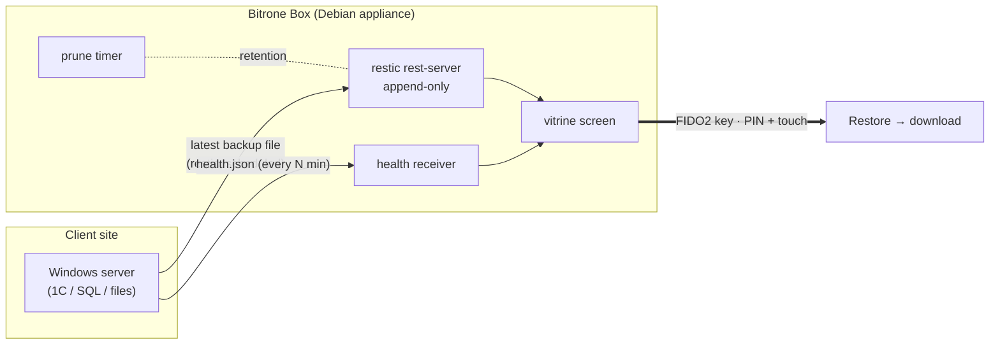

<p align="center">
  
</p>

<h1 align="center">Bitrone Box</h1>

<p align="center">
  <b>Ransomware-proof backups · live server health · restore only with a physical key</b><br>
  A small appliance that sits in your server room and keeps your data safe even when everything else is compromised.
</p>

<p align="center">
  
  
  
  
</p>

---

## Why

A single ransomware infection usually encrypts the servers **and the backups** — because the
backups sit on a share the server can write to. Bitrone Box breaks that chain:

- backups are **append-only** — the client can write new copies but **can't delete or overwrite** them;
- copies are **encrypted** and **stay on your LAN**, not in someone's cloud;
- restoring data requires a **physical FIDO2 key** with **PIN + touch** — not even a stolen box gives up the data;
- a screen in the server room shows the **live health** of every server at a glance.

## Features

| | |
|---|---|
| 🔒 **Immutable backups** | restic in `--append-only` mode — ransomware can't erase history |
| 🏠 **Your data, your network** | copies live on the box in your office, never the cloud |
| 🔑 **FIDO2-gated restore** | decrypt/restore only with a hardware key (PIN + touch) |
| 📊 **Health vitrine** | on-screen: disks/SMART, ECC memory, BSOD/WHEA, RDP, updates, activation — up to 2 servers |
| 🧹 **Automatic retention** | old copies pruned by policy on the box (clients can't delete) |
| 🖥 **Touchscreen restore** | tap the screen → PIN pad → key → progress bar → 3-hour download link |

## How it works



- **Backup:** a Windows service sends the newest backup file to the box via restic (encrypted, append-only).
- **Health:** a read-only collector posts server vitals to the box; the screen switches to an 8-panel dashboard.
- **Restore:** from the screen or console — gated by a FIDO2 key (PIN + touch); the file is served for 3 hours, then auto-deleted.

## Repository layout

```
box/            the appliance (Debian)
  install-box.sh        one-command setup (orchestrates everything below)
  restic/               append-only receiver, prune, restore, save-repo-pass
  health/               health receiver (HTTP) + installer
  fido2/                FIDO2-gated restore, PIN pad launcher, enrollment
  status/               the vitrine (tkinter) + status builder
  enclosure/ stand/ stickers/ firmware/   hardware, 3D models, firmware
agent/windows/  the client (Windows server)
  install-bitrone-backup.ps1   installer (backup + health)
  restic-backup.ps1            sends the latest file
  collect-health.ps1           read-only health collector
  installer/                   Inno Setup → BitroneBackupSetup.exe (bundles restic)
docs/           guides (incl. restic + Token2 FIDO2)
marketing/      one-pagers, status creatives
```

## Quick start

**On the box** (Debian), copy `box/` and run one command:

```bash
sudo bash box/install-box.sh          # asks serial + client, brings up all services
sudo bash box/fido2/install-restore.sh && sudo bash box/fido2/enroll-fido2.sh   # FIDO2 restore
```

**On the client server** (Windows), run `BitroneBackupSetup.exe` (or `install-bitrone-backup.ps1`) and fill in:
box address · backup folder · extension · backup time · health token · health interval.

See [`box/README.md`](box/README.md), [`box/restic/README.md`](box/restic/README.md) and
[`box/fido2/README.md`](box/fido2/README.md) for details.

## Security model

- **Anti-ransomware:** the client writes through an append-only REST server — it has no delete path.
  Retention (`forget --prune`) runs **only on the box**.
- **Encryption:** restic encrypts client-side (AES-256); the box stores only ciphertext.
- **Restore authorization:** `pam_u2f` requires a registered FIDO2 key with **PIN + touch**.
  For a cryptographic bind (the key *derives* the repository password via FIDO2 `hmac-secret`),
  see [`docs/restic-token2-fido2.md`](docs/restic-token2-fido2.md).

## Tech stack

[restic](https://restic.net) · rest-server · Debian · Python/tkinter · `libpam-u2f` / `libfido2` ·
PowerShell · Inno Setup. Built on proven, audited open source — no home-grown crypto.

## Roadmap

- [ ] FIDO2 `hmac-secret` wrapping of the repo password (even root can't decrypt without the key)
- [ ] Integrity guard: only back up files idle for N minutes (never grab a half-written dump)
- [ ] Repeatable box image / provisioning
- [ ] Second off-site copy (restic replication)

## License

© 2026 Bitrone. All rights reserved. Source is published for transparency and verification;
it may not be redistributed or used commercially without permission.

## Contact

**Bitrone** · [soc.bitrone.az](https://soc.bitrone.az) · +994 70 577 64 00
