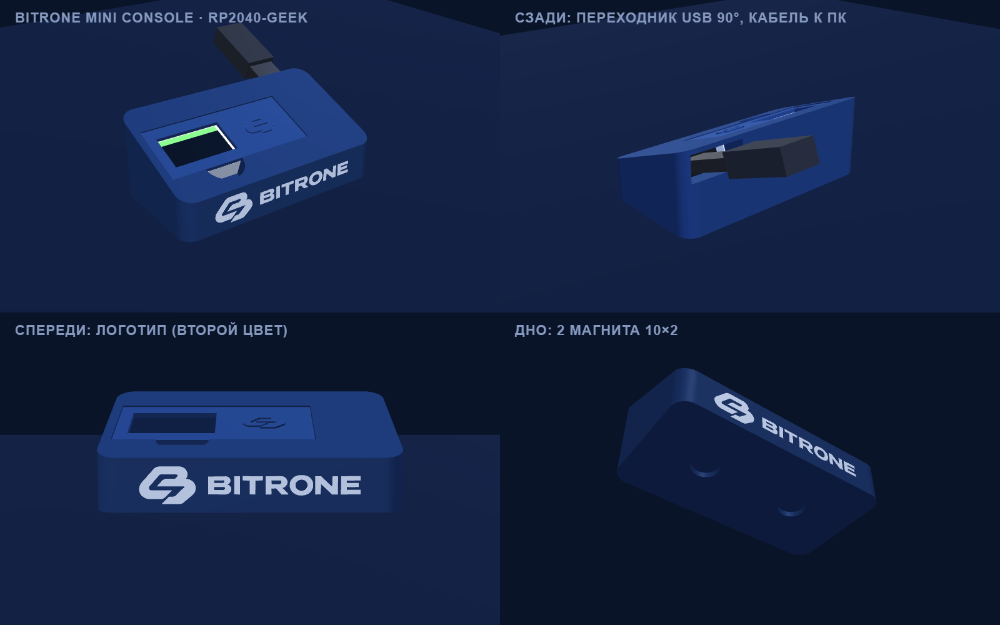

# Bitrone Box — мини-консоль под RP2040-GEEK (вариант B)



Клин 90 × 48 × 34 мм. Экран GEEK смотрит вверх под углом ~21°, видно только экран
(рамка закрывает белый корпус). Логотип Bitrone спереди — вторым цветом.
Ставится рядом с мини-ПК или крепится на его стальную крышку двумя магнитами.

## Файлы для печати (`stl/`)

| Файл | Что | Материал | Вес |
|---|---|---|---|
| `bitrone_mini_console.stl` | корпус | PETG, тёмно-синий/чёрный | ~45 г |
| `bitrone_mini_logo_inlay.stl` | заливка логотипа | PETG белый — **вторым цветом в том же задании** | <1 г |
| `bitrone_mini_bezel.stl` | рамка поверх GEEK, окно над экраном | PETG, цвет корпуса | ~2.5 г |

**Печать корпуса:** дном вниз, слой 0.2 мм, 4 стенки, заполнение 15 %.
Поддержки — только в прорези переходника сзади (остальное без поддержек).

**Логотип вторым цветом:** загрузите `console` и `logo_inlay` вместе как одну модель
из двух частей (координаты уже совпадают) и назначьте `logo_inlay` белый пластик.
Если принтер одноцветный — печатайте только корпус, гравировку закрасьте белой краской
(маркер Edding 780 или акрил).

## Что купить

| Деталь | Примечание |
|---|---|
| Waveshare RP2040-GEEK | ~9 $ |
| Угловой переходник USB-A «папа–мама» 90° | направление — чтобы штекер шёл **назад**, когда экран GEEK смотрит вверх; надёжнее взять сразу «left» и «right» |
| Удлинитель USB-A «папа–мама» 0.5–1 м | от переходника к мини-ПК |
| 2 магнита 10 × 2 мм (неодим) | вклеить в дно (по желанию) |
| 4 резиновые ножки | если ставить на стол |

## Сборка

1. Вклеить магниты в гнёзда дна (суперклей), одинаковой полярностью наружу.
2. Вставить угловой переходник в прорезь **сзади**, штекером наружу.
3. Вставить GEEK в карман: штекер GEEK — в переходник, экран вверх.
4. Положить сверху рамку (окно над экраном). Держится на трении; вынуть — поддеть
   за выемку спереди.
5. Удлинитель: переходник → USB мини-ПК.

## Перед печатью — измерить свои детали

Размеры в `build_console.py` (`PARAMS`) взяты по описанию; у конкретной партии могут
отличаться на 0.5–1 мм. Измерьте штангенциркулем и поправьте:

- `geek_l`, `geek_w`, `geek_t` — корпус GEEK **без** USB-штекера;
- `screen_x`, `screen_l`, `screen_w` — где на GEEK экран (для окна рамки);
- `adp_l`, `adp_w`, `adp_t` — угловой переходник.

Пересборка STL (нужны `manifold3d`, `numpy`):

```bash
python box/stand/mini/build_console.py --out box/stand/mini/stl
python box/stand/mini/build_console.py --out /tmp/x --assembly   # + макеты GEEK для рендеров
```

Логотип взят из `frontend/logo.png` и обведён в контуры скриптом `trace_logo.py`
(результат — `logo_paths.json`; эти же контуры подойдут для наклейки).
